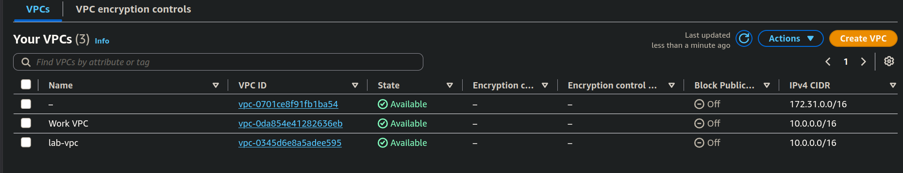
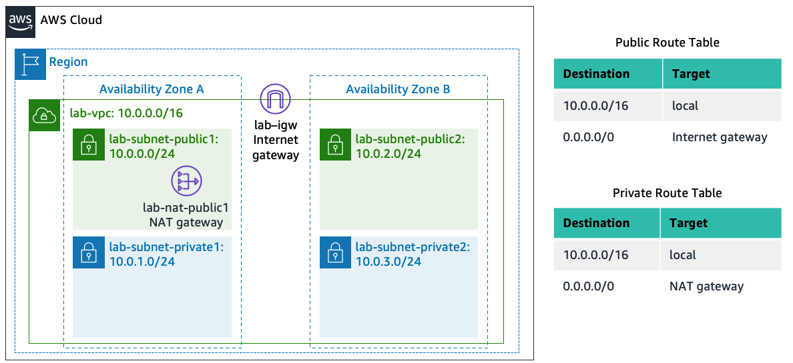
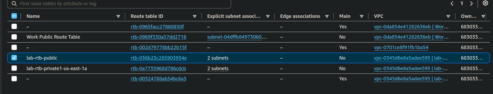
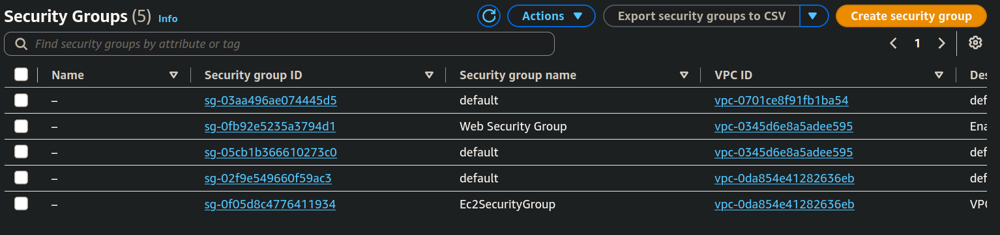
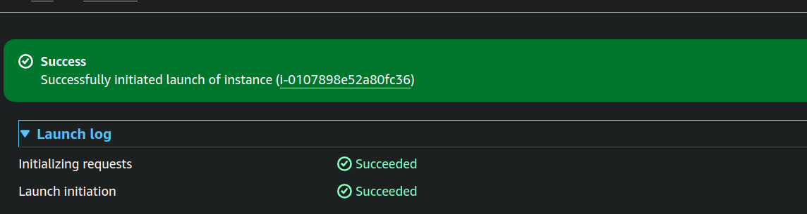
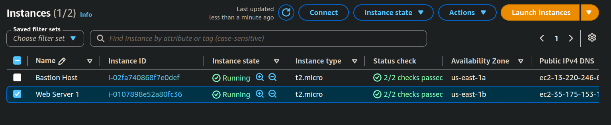

## Building VPC and Launching a Web Server

**Task 1: Create Your VPC**

A secure virtual network is created in us-east-1 and 2 subnets are created that are public and private. The public subnet is configured to have external access to the internet, while the private subnet is configured to have no access to outside world. 

**Task 2: Create Additional Subnets**

Created two additional subnets for the VPC in second availability Zone. The first public subnet (10.0.2.0/24) is linked to the Internet Gateway. The second private subnet (10.0.3.0/24) is linked to the NAT Gateway so it can safely download updates without being exposed to the internet. The route table need to be configured to expose the subnet. 

**Task 3: Create a VPC Security Group**

Successfully created a security group inside the lap-vpc. The security group is configured to allow HTTP traffic from anywhere on the internet that is (0.0.0.0/0). 

**Task 4: Launch a Web Server Instance**

Final Outcome: Deployed a t2.micro instance named Web Server 1 running Amazon Linux 2023 within lab-subnet-public2. It was assigned a public IP and protected by the Web Security Group. A user data startup script successfully automated the installation of Apache, PHP, and a database, pulling down the lab application files so the web server became fully accessible via its public IPv4 DNS address.

