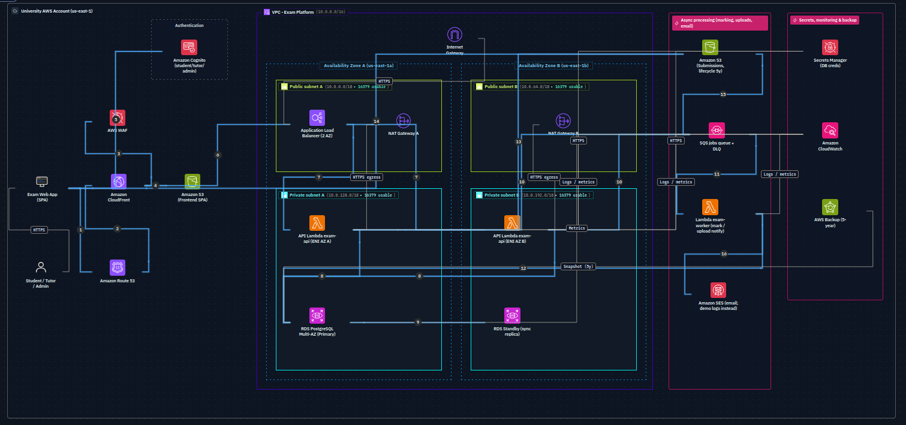
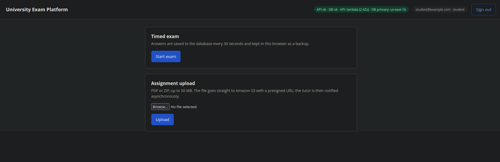

# DSO303 Assignment 2 – Online Exam Platform on AWS

A university platform for timed online exams and assignment submissions, built for 8,000 students and 400 staff with an exam-week peak of 3,000 students starting within 5 minutes.

## Architecture summary



| Layer | Services |
|---|---|
| Edge | Route 53 (design), CloudFront, AWS WAF |
| Frontend | Private S3 bucket served through CloudFront (Origin Access Control) |
| Identity | Amazon Cognito: groups `student`, `tutor`, `admin` |
| Network | VPC `10.0.0.0/16`: public and private subnets in **us-east-1a and us-east-1b**, Internet Gateway, one NAT gateway per AZ |
| API | Application Load Balancer (both public subnets) → **Lambda `exam-api`** in both private subnets |
| Database | **RDS PostgreSQL Multi-AZ** (synchronous standby in the other AZ), credentials in Secrets Manager |
| Files | S3 submissions bucket: versioned, encrypted, lifecycle 30 d → IA → 365 d → Glacier → delete at 5 years |
| Async | S3 events and submit jobs → SQS (+ dead-letter queue) → Lambda `exam-worker` (auto-marking, tutor notification) → SES |
| Operations | CloudWatch alarms and logs, AWS Backup (monthly, kept 5 years) |

- Exam peak and AZ loss: [`architecture/peak-and-az.md`](architecture/peak-and-az.md)
- Every service, with justification and configuration: [`docs/services.md`](docs/services.md)
- Cloud Architecture Lab design file: [`architecture/exam-platform-lab.json`](architecture/exam-platform-lab.json)

## Repository layout

```
README.md
architecture/   diagram.png, exam-platform-lab.json, walkthroughs.md, peak-and-az.md
docs/           services.md
evidence/       Cloud Architecture Lab simulations + AWS deployment screenshots
infra/          AWS CLI scripts that build, verify and remove everything
  00-config.sh          settings + helpers (region, name prefix, emails)
  01-network.sh         VPC, subnets, IGW, NAT ×2, routes, security groups
  02-database.sh        RDS PostgreSQL Multi-AZ + Secrets Manager
  03-storage.sh         S3 submissions (lifecycle) + frontend buckets
  04-auth.sh            Cognito user pool, groups, test users
  05-async.sh           SQS + DLQ, S3 → SQS events, SES, worker Lambda
  06-compute.sh         ALB (+ the original ECS Fargate service, later retired)
  07-edge.sh            WAF, CloudFront, Origin Access Control
  08-monitoring.sh      CloudWatch alarms
  09-backup.sh          AWS Backup 5-year plan
  11-api-lambda.sh      API as a Lambda behind the ALB + publish the web page
  10-deploy-app.sh      (alternative) the same API as a container on ECS Fargate
  verify.sh             automated checks for each phase (1–11)
  e2e-test.py           end-to-end test of both walkthroughs through CloudFront
  99-teardown.sh        deletes everything in reverse order
  app/api/              API code (app.py, lambda_handler.py, Dockerfile)
  frontend/index.html   exam web page
  lambda/worker.py      async worker
```

## Deploy

The infrastructure is fully scripted with the AWS CLI. Each script saves the IDs it creates to `infra/ids.env`, so the next script can use them.

```bash
cd infra
nano 00-config.sh                 # set AWS_PROFILE and the two email addresses
bash 01-network.sh   && bash verify.sh 1
bash 02-database.sh  && bash verify.sh 2     # ~20 min (Multi-AZ)
bash 03-storage.sh   && bash verify.sh 3
bash 04-auth.sh      && bash verify.sh 4
bash 05-async.sh     && bash verify.sh 5
bash 06-compute.sh                           # creates the ALB (and a placeholder ECS service)
bash 07-edge.sh      && bash verify.sh 7     # ~15 min (CloudFront)
bash 08-monitoring.sh && bash verify.sh 8
bash 09-backup.sh    && bash verify.sh 9
bash 11-api-lambda.sh && bash verify.sh 11   # API on Lambda, ECS scaled to 0, web page published
bash verify.sh 10                            # both walkthroughs end to end
```

## Deploy

The infrastructure is fully scripted with the AWS CLI. Each script saves the IDs it creates to `infra/ids.env`, so the next script can use them. After each script, `verify.sh <phase>` checks that the phase was built correctly.

```bash
cd infra
nano 00-config.sh                 # set AWS_PROFILE and the two email addresses
bash 01-network.sh   && bash verify.sh 1
bash 02-database.sh  && bash verify.sh 2     # ~20 min (Multi-AZ)
bash 03-storage.sh   && bash verify.sh 3
bash 04-auth.sh      && bash verify.sh 4
bash 05-async.sh     && bash verify.sh 5
bash 06-compute.sh                           # creates the ALB (and a placeholder ECS service)
bash 07-edge.sh      && bash verify.sh 7     # ~15 min (CloudFront)
bash 08-monitoring.sh && bash verify.sh 8
bash 09-backup.sh    && bash verify.sh 9
bash 11-api-lambda.sh && bash verify.sh 11   # API on Lambda, ECS scaled to 0, web page published
bash verify.sh 10                            # both walkthroughs end to end
```

| Step | What every script does |
|---|---|
| `00-config.sh` | Shared settings (region, name prefix, AWS profile, emails) and helper functions. Every other script loads it. |
| `01-network.sh` | Creates the VPC with public and private subnets in two AZs, the Internet Gateway, one NAT gateway per AZ, the route tables, and the security groups (ALB → API → database). |
| `02-database.sh` | Creates the RDS PostgreSQL database in Multi-AZ mode inside the private subnets. The database password is generated and stored in Secrets Manager. |
| `03-storage.sh` | Creates two private, encrypted S3 buckets: one for the web page and one for assignment uploads, with versioning and the 5-year lifecycle rule. |
| `04-auth.sh` | Creates the Cognito user pool with the student, tutor and admin groups, plus one test user for each role. |
| `05-async.sh` | Creates the SQS job queue and its dead-letter queue, connects S3 upload events to the queue, and deploys the worker Lambda that processes the jobs. |
| `06-compute.sh` | Creates the Application Load Balancer across both public subnets. It also builds the original ECS container service, which step 11 later replaces. |
| `07-edge.sh` | Creates the WAF rules and the CloudFront distribution. CloudFront serves the web page from S3 and sends `/api` requests to the load balancer. |
| `08-monitoring.sh` | Creates CloudWatch alarms for API errors, database CPU and storage, and failed jobs in the dead-letter queue. |
| `09-backup.sh` | Creates an AWS Backup plan that backs up the database monthly and keeps each backup for 5 years. |
| `11-api-lambda.sh` | Packages the API code as a zip and runs it as a Lambda in both private subnets. It then points the load balancer at the Lambda, scales the containers to 0, and publishes the exam web page. |
| `verify.sh 10` | Runs both walkthroughs end to end through CloudFront: sign in, start the exam, autosave, submit, upload a file, and check that the worker Lambda processed the jobs. |

The screenshots of each script's output are in assets/ folder.

The site is then at `https://dbvrv1swyk8fg.cloudfront.net/`. Test users (password `Exam@2026`): `student@example.com`, `tutor@example.com`, `admin@example.com`.


this is website that is hosted on cloudfront and the backend is hosted on lambda and the database is hosted on RDS.

**Free-plan account:** `02-database.sh` uses 1 day of backup retention by default because free plan accounts cannot set a longer retention.

## Test the AZ failover

```bash
source 00-config.sh
aws rds reboot-db-instance --db-instance-identifier $DB_ID --force-failover
for i in $(seq 1 12); do echo "$(date +%T) $(curl -s -m 10 https://$CF_DOMAIN/api/health)"; sleep 10; done
```
The web page's header badge shows the current **DB primary** AZ, which flips during the test. Answers typed during the switch are kept in the browser and saved once the database is back.


<!-- 
## Tear down

```bash
cd infra
bash 99-teardown.sh
```
This deletes everything in reverse order: Backup, alarms, CloudFront and WAF, the Lambdas, ALB, ECS/ECR, SQS, Cognito, both S3 buckets (all object versions), RDS, the IAM roles, and finally the network. It takes 25–40 minutes, mostly waiting for CloudFront, RDS and the release of Lambda network interfaces. It is safe to re-run. Afterwards, check **Billing → Bills** to confirm nothing remains. -->

## Limitations of the demo deployment

| Item | Demo | Production |
|---|---|---|
| Custom domain | Default `*.cloudfront.net` name; Route 53 is in the design only | Route 53 alias + ACM certificate |
| CloudFront → ALB | HTTP (the ALB has no certificate without a domain); browser ↔ CloudFront is HTTPS | HTTPS listener on the ALB with an ACM certificate |
| RDS backup retention | 1 day (Free-plan limit); point-in-time restore still works | 7–35 days, plus AWS Backup for 5 years |
| Email | Notifications logged by the worker (no verified mailbox) | SES with a verified domain, out of the sandbox |
| Lambda concurrency | Account default of 10 | Quota increase (e.g. 1,000) + RDS Proxy for DB connections |
| Marking result | Score written to the worker's log | Worker writes the score to RDS |
| Infrastructure as code | AWS CLI scripts (reproducible, ordered, verified) | Terraform/CloudFormation with a CI/CD pipeline on push to `main` |
<!-- 
## Evidence

| File in `evidence/` | Shows |
|---|---|
| `lab-01-architecture.png` | Cloud Architecture Lab: full design across two AZs |
| `lab-02-walkthrough1.png` | Lab simulation: exam open + autosave |
| `lab-03-walkthrough2.png` | Lab simulation: upload + tutor notification |
| `lab-04-az-failure-before.png`, `lab-05-az-failure-after.png` | Lab simulation: AZ A failure |
| `aws-phase1-network.png` … `aws-phase11-lambda.png` | `verify.sh` output for each phase (all ✅) |
| `aws-vpc-resource-map.png` | VPC with public and private subnets in both AZs |
| `aws-rds-multi-az.png` | RDS configuration: Multi-AZ, primary and secondary zones |
| `aws-e2e-walkthroughs.png` | `verify.sh 10`: both walkthroughs end to end |
| `aws-site-exam-autosave.png` | Web page: signed in, exam autosaved |
| `aws-site-upload.png` | Web page: upload complete; file in the S3 console |
| `aws-failover-*.png` | Forced RDS failover: AZ swap, health loop, RDS events, page still saving | -->
